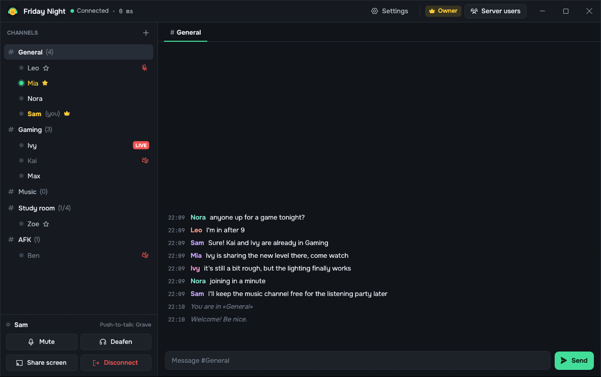
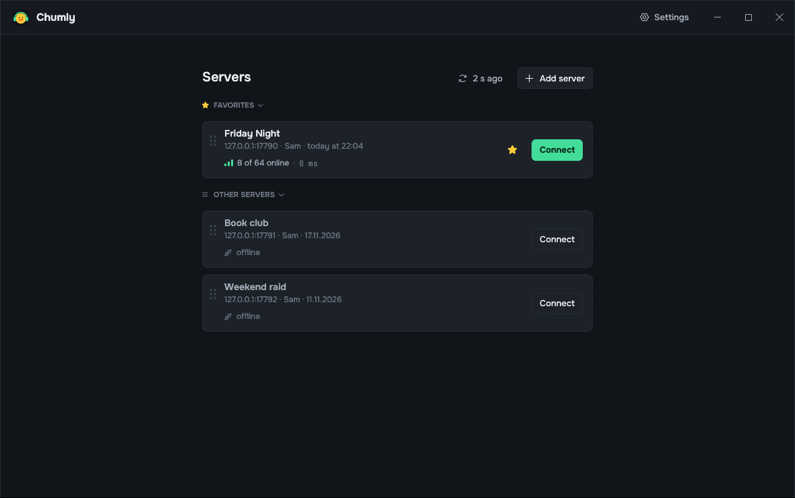
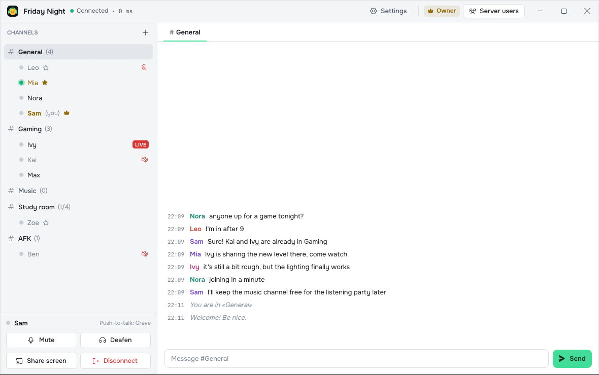
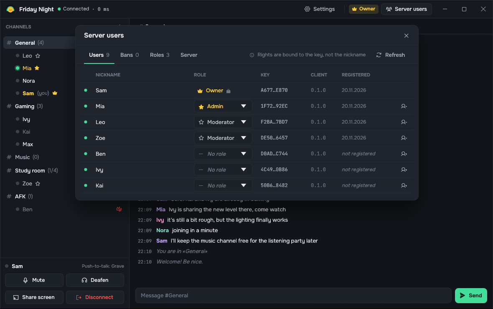
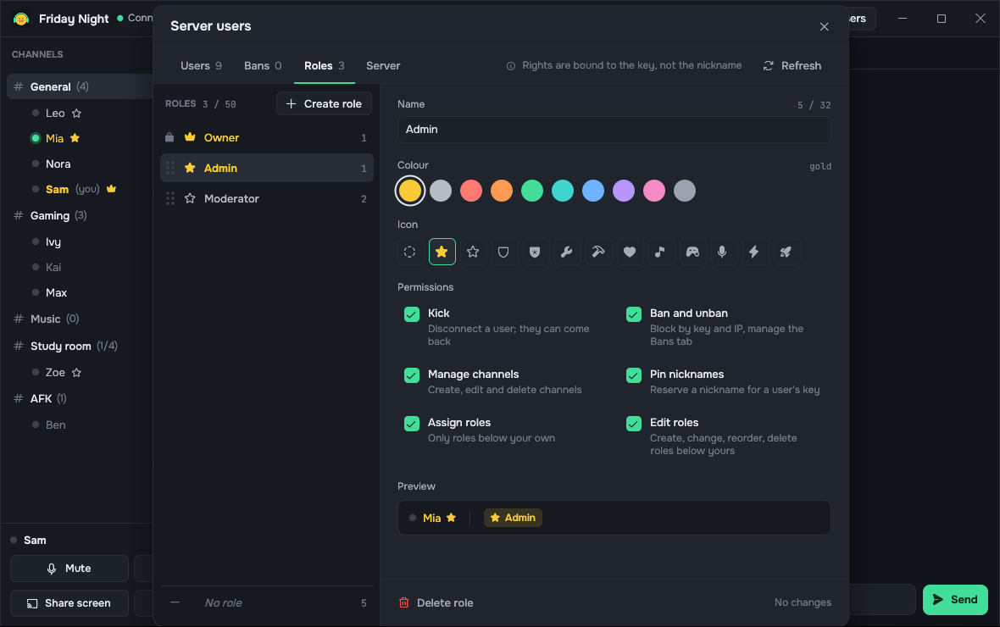

# Chumly

A small self-hosted voice chat: a desktop client and a lightweight server, written in Rust.



- Voice over QUIC datagrams, Opus codec, noise suppression (RNNoise), jitter buffer with FEC
- Push-to-talk or voice activation, global hotkeys for mute/deafen
- Channels with user limits, text chat, private messages
- Screen sharing (H.264) with audio on Windows and Linux (X11 and Wayland), and a live
  preview of your own stream; everyone sees who is watching
- Event sounds in groups that can be silenced one by one, with their own volume
- Server roles bound to user keys (owner, admin, moderator by default; your own roles with chosen rights), registered nicknames; kick, ban and channel
  management from the client or the server console
- Self-signed TLS with certificate pinning on first connect (like SSH)
- UI in English and Russian

> **Linux screen sharing is new.** It is tested on Ubuntu 26.04 (GNOME, Wayland) and
> Linux Mint (X11); other desktops (KDE, Fedora and others) should work but are not tested
> yet. Known so far: with GNOME, a fullscreen video may freeze for viewers while its
> controls are hidden (moving the mouse brings it back). If something does not work on
> your system, please [open an issue](../../issues) and mention your distribution and
> desktop.

<table>
  <tr>
    <td></td>
    <td></td>
  </tr>
  <tr>
    <td align="center">Server list: who is online before you connect</td>
    <td align="center">Light theme</td>
  </tr>
  <tr>
    <td></td>
    <td></td>
  </tr>
  <tr>
    <td align="center">Server users: roles, keys, registered nicknames</td>
    <td align="center">Your own roles with chosen rights</td>
  </tr>
</table>

## Download

Prebuilt binaries are on the [Releases](../../releases) page:

| Archive | Platform |
|---|---|
| `chumly-client-windows-x64` | Client, Windows 10+ |
| `chumly-client-linux-x64` | Client, Linux x86_64: Ubuntu 22.04, Mint 21, Debian 12 or newer; needs PipeWire (`libpipewire-0.3`, desktop systems have it); push-to-talk needs X11 |
| `chumly-server-linux-x64` | Server, Linux x86_64 |
| `chumly-server-linux-arm64` | Server, Raspberry Pi (64-bit OS) and other ARM64 Linux |
| `chumly-server-windows-x64` | Server, Windows |

### Checking a download

Every release file has a [minisign](https://jedisct1.github.io/minisign/) signature next to it
(`<file>.minisig`), and `SHA256SUMS` lists the checksums of all files. The public key is
[`minisign.pub`](minisign.pub) in this repository:

```sh
minisign -Vm chumly-client-windows-x64-0.1.0.exe -p minisign.pub
```

"Signature and comment signature verified" means the file is exactly what was released.

## Server

### Quick start

```sh
./chumly-server                       # uses server.toml in the current directory
./chumly-server --config /path/to/server.toml
```

On first run the server creates `server.toml` with defaults and starts listening on
**UDP port 7777**. While the server has no owner, it prints a one-time **admin setup code**
to the log (see [Admins and roles](#admins-and-roles)).

To let people connect from the internet:

- forward **UDP** port 7777 on your router to the server machine (TCP is not used);
- allow it in the firewall: `sudo ufw allow 7777/udp` on Linux; on Windows allow the
  firewall prompt on first run.

Then give your friends the address (`your-ip:7777`) and the server password, if you set one.

### Configuration

All settings are in `server.toml`. Restart the server after editing it.

```toml
name = "Chumly Server"     # shown in the client
motd = "Welcome!"          # message shown on join
bind = "0.0.0.0:7777"      # address and UDP port
password = ""              # shared join password; empty = anyone can join
max_users = 64
max_connections_per_ip = 5 # raise it if many people connect from behind one router
history_size = 100         # chat messages kept in memory per channel
public_status = true       # name, version and online count visible before connecting
check_updates = true       # at startup, log if a newer release is on GitHub

[[channels]]               # the first channel is where users land on join
name = "General"
description = "Main channel"

[[channels]]
name = "Meeting room"
max_users = 5              # optional per-channel limit
```

For a private server, set `password`, or let the owner do it from the client (**Server users**
→ **Server**) or the console (`password set …`); both save it to `server.toml` at once, without
a restart. Users already connected stay.

Built-in abuse protection: after 5 wrong passwords or setup codes within 10 minutes the
address is blocked for 15 minutes (`unban <ip>` in the console lifts it early). Chat is limited
to bursts of 10 messages and then 1 per second, channel switches to 5 and then 1 per second,
a client flooding control messages is disconnected, and voice and screen share traffic per user
is capped.

The chat history is kept in memory only and is lost
when the server restarts.

Channels can also be managed at runtime, from the console or from the client as admin.
The server then rewrites the `[[channels]]` section and leaves the rest of the file intact.

### Files

Everything is stored next to `server.toml`:

| File | Contents |
|---|---|
| `server.toml` | settings and channels |
| `cert.der`, `key.der` | server certificate, created on first run |
| `bans.toml` | ban list |
| `users.toml` | roles (most senior first) and registered users: key, nickname, role |

Keep the certificate and its key when you update or move the server. Clients remember the
fingerprint of the server's key (`key.der`; the log shows it at startup as `server key
fingerprint`) on first connect; with a new key every client shows a "certificate changed"
warning. Users' keys are also derived from it (see [Identity](#identity)): with a new key every
user shows up with a new key, bans by key stop matching, and registrations and roles in
`users.toml` no longer match anyone. The server warns about this at startup; bind users back
with `rebind`. **Back up `cert.der` and `key.der` together with `users.toml`.**

`key.der` is what matters: if only `cert.der` is lost, the server issues a new certificate for
the same key at startup and nothing changes for clients. If `key.der` is missing while
`cert.der` exists, the server refuses to start instead of silently making a new key: restore
`key.der` from a backup, or delete `cert.der` to start over with a new key.

`key.der` and `server.toml` (it holds the password) are created readable by the server's user
only (mode 600 on Linux; on Windows only that user and the system).

### Console commands

Type commands into the server window:

```
list                         who is connected
channels                     list channels with ids
addchan <name>               create a channel
renamechan <channel> <name>  rename a channel
limit <channel> <n>          channel user limit; 0 = no limit
delchan <channel>            delete a channel, move its users to the first free one
kick <nick> [reason]         kick a user
ban <nick> [time] [reason]   ban by nickname, IP and key; time: 30m, 12h, 7d,
                             2w (at most a year); without it, permanent
unban <nick|ip|key>          remove a ban; for an ip also lifts the wrong-password block;
                             a key can be given by its first 8 bytes, as list/bans show it
bans                         list bans: when each ends and who issued it
users                        registered users and their roles
register <nick>              register an online user's nickname to their key
unregister <nick>            remove a registration (and the role)
roles                        roles, most senior first, with their rights
grant <nick> <role>          give an online user a role by name (registers the nickname)
revoke <nick>                take the role away, the nickname stays registered
rebind <registered> <online> bind a registration to the key of an online user
owner <nick>                 make an online user the server owner (the previous owner
                             gets the next role down); the only way the owner role moves
setupcode                    show the setup code, if the server has no owner yet
password                     whether the server has a password
password set <password>      set or change it (asks to type it again)
password remove              remove it (asks to confirm)
say <text>                   announcement to all users
quit                         stop the server
```

`<channel>` is an id from `channels` or a name without spaces.

`list` and `bans` show each user's key (the first 8 bytes of its fingerprint). A ban covers
the key too, so changing the nickname and the address does not get around it while the user
keeps the same identity. A ban can be temporary: from the client (1 hour, 1 day, 1 week,
30 days or permanent) or from the console (`ban vasya 1d spam`). A temporary ban ends by
itself; the banned user sees until when, in their own time zone, and how long is left. A client whose identity file cannot be read connects without a key
(shown as `-`).

### Running as a service (Linux)

A systemd unit, for example `/etc/systemd/system/chumly.service`:

```ini
[Unit]
Description=Chumly voice server
After=network-online.target
Wants=network-online.target

[Service]
User=chumly
WorkingDirectory=/home/chumly/chumly
ExecStart=/home/chumly/chumly/chumly-server
# The server shuts down gracefully (notifies users) on Ctrl+C, i.e. SIGINT.
KillSignal=SIGINT
Restart=on-failure

[Install]
WantedBy=multi-user.target
```

```sh
sudo systemctl daemon-reload
sudo systemctl enable --now chumly
journalctl -u chumly -f               # log
```

A service has no console, so use admin commands from the client (see below).

To update, replace the binary and restart the service; the config, certificate and bans
stay as they are.

## Client

1. Start `chumly.exe` (Windows) or `chumly` (Linux).
2. Click **Add server** and enter the address (`host:port`, e.g. `1.2.3.4:7777`), your nickname
   and the server password (leave it empty if there is none).
3. Click **Connect**. On first connect the client remembers the server certificate. If it changes
   later, the client warns you before connecting.

The server list shows each server's status before you connect, with signal bars: how many
people are online and the ping ("5 of 64 online · 23 ms"), just "online" for servers that do not
share counts, "offline", or "certificate changed" (an orange card with **Review…**, a warning
before connecting). It refreshes every 15 s while visible, or with the refresh button. Star a
server to pin it to **Favorites** at the top; drag a card by its handle to reorder; new servers
go to the top, under the favorites; groups collapse on click; a search field appears from 8
servers. **Settings → General → Connect on start** connects to the last used server.

While connected, the top bar shows the connection quality: "● Connected · 23 ms" (the dot is
green, orange or red), and a red "Poor connection" pill when it is bad. Hover or click it for
details: ping, packet loss, lost and late voice packets, traffic, server version and protocol.

In the client:

- double-click a channel to join it; right-click a user for private messages and their volume;
- **Settings**: microphone and speakers, voice activation or push-to-talk, noise suppression,
  hotkeys for mute/deafen, language and theme. On first start the language follows the system:
  Russian on a Russian system, English otherwise;
- admins and moderators get their tools in the user's and the channel's right-click menu
  (see [Admins and roles](#admins-and-roles)).

**Crash reports.** If the client crashes, it saves a report in `crashes/` next to
`client.toml` (the newest five are kept). On the next start a banner offers to copy it or open
the folder. Nothing is sent anywhere. The report has the version, the system, the error and
where in the code it happened; no recovery code, passwords or server addresses.

Settings are stored in `%APPDATA%\Chumly\config\client.toml` on Windows and
`~/.config/chumly/client.toml` on Linux. **Portable mode**: put a `client.toml` (an empty file
is fine) next to the executable, and the client keeps its settings there instead.

### Identity

On first start the client creates `identity.txt` next to `client.toml`: a secret recovery code.
For every server the client derives its own key from that code and the server's public key, and
the server recognizes you by it. Servers cannot tell that keys on different servers belong to the
same person, yet the one code restores your identity everywhere.

Back it up: **Settings → Identity → Show code / Copy**, and keep it in a password manager or on
paper. On a new computer use **Restore from code…**. Anyone who has the code can sign in as you. The client creates `identity.txt` and
`client.toml` (it holds server passwords) readable by your user only, also in portable mode.
Registered nicknames and roles on servers are tied to these keys: without the code they are lost
(an admin can register you again).

## Admins and roles

Rights are bound to the user's key (see [Identity](#identity)), not to a password. A user has
one role or none. Roles are the server's data, like groups in TeamSpeak: each has a name, a
color, an icon and rights, and their order is the hierarchy (higher in the list is more senior).
Rights:

| Right | Allows |
|---|---|
| `kick` | kick users below |
| `ban` | ban users below, see and lift bans |
| `channels` | create, edit and delete channels |
| `register` | register nicknames to keys and remove registrations |
| `assign_roles` | give and take roles below one's own |
| `edit_roles` | create, edit, reorder and delete roles below one's own |

A new server has three roles: **Owner** (the one who entered the setup code; all rights, never
edited), **Admin** (all rights) and **Moderator** (kick). A **registered nickname** cannot be used
by anyone else; a registered user who connects under a new nickname keeps their role, and the
registration moves to the new name.

**The rule for every action on another user** (role, kick, ban, nickname registration): only on
users strictly below you, so never on yourself, an equal or someone higher. Roles are given and
edited only below your own, and a role cannot get a right its editor does not have. Two admins
cannot demote or ban each other, and an admin cannot make another admin.

Roles are stored in `users.toml` (rights by name, so it can be edited by hand while the server is
stopped). A `users.toml` without roles gets the three default ones.

**The owner.** While `users.toml` has no owner, the server prints a one-time code to its log at
startup, e.g. `Admin setup code: 020Z-3QGW` (on a systemd service: `journalctl -u chumly`; in the
console: `setupcode`). Connect with the client, click **Become owner** and enter the code: your
key becomes the owner and the code stops working. The button is shown only while the server has
no owner. The owner role moves only with the console command `owner <nick>` (the previous owner
gets the next role down). Lost the owner's key and have no console? Remove the owner's entry from
`users.toml` and restart the server: it prints a new setup code.

Roles are given from the user's right-click menu (**Assign role**) or with `grant` in the console.
With `edit_roles`, the **Roles** tab of **Server users** edits them: drag a role to reorder it
(saved at once), pick a name, one of 10 colors, one of 12 icons and the rights, then **Save**.
Roles at or above your own open read-only, and rights you do not have are locked. A role name is
up to 32 characters, without spaces at the ends, line breaks, or `@` / `#` at the start; names
are unique regardless of case.
**Server users** (a button for those with `ban`, `register`, `assign_roles` or `edit_roles`) lists all registered users (online or not) and everyone
online who is not registered; there roles are changed and nicknames registered or unregistered.
The second tab is the ban list with **Unban** (with the `ban` right), the third the roles.
The owner also gets a **Server** tab: set, change (typed twice) or remove (with a confirmation)
the server password. The password is never shown, only whether there is one.

A client without a key (its `identity.txt` cannot be read) cannot get a role or a registered
nickname.

## Versions and updates

Client and server do not have to run the same version. A release may change only the client
(for example, the interface) or only the server (for example, security fixes); the release
notes say whether the client, the server or both need updating.

- **Compatible updates** are the norm: a newer client works with an older server and the
  other way round. Features that need both sides simply stay off until both have them.
- **Incompatible changes** are rare and announced in the release notes. Even then a client
  and a server one step apart keep working: each supports the current and the previous
  protocol version. Only a client and a server too far apart refuse to connect, with the
  message "the client and server versions are incompatible".
- **The server owner** sees "Server outdated" in the client only when the client has a
  feature that needs the server and the server lacks it; the tooltip lists what is missing.
  Nobody is warned just because a version number is lower.
- **New releases.** The client asks GitHub for the latest release at launch and once a day
  and shows "Chumly X is available" with What's new and **Update and restart**: it downloads
  the file for your system, checks its minisign signature against the key built into the
  client, replaces itself and restarts (in a call, it asks first). If the folder of
  `chumly.exe` is not writable, download the file manually and replace the exe. "Skip this
  version" silences that version until the next one. Settings → General → Updates turns the automatic check off; "Check now" still
  works. The server writes a newer release to its log at startup (`check_updates` in
  `server.toml`). Either way GitHub sees only the IP address and the app version.
- **Server users** in the admin panel shows each online user's client version, and the
  console command `list` shows it too. The server's version is shown as a tooltip on its
  name in the client.

## Building from source

Requires a recent stable Rust toolchain (edition 2024) and a C compiler. Building the Opus codec
also needs CMake.

```sh
cargo build --release              # both, binaries in target/release/
cargo build --release -p client    # chumly(.exe)
cargo build --release -p server    # chumly-server(.exe)
cargo test                         # unit tests
```

On Linux the client needs `libasound2-dev libx11-dev libxkbcommon-dev libwayland-dev
libpipewire-0.3-dev libclang-dev`. PipeWire headers must be 1.x (Ubuntu 24.04 and newer);
on older systems see `.github/scripts/pipewire-headers.sh`, which the release build uses on
Ubuntu 22.04.

Cross-compiling the server for a Raspberry Pi with [cargo-zigbuild](https://github.com/rust-cross/cargo-zigbuild):

```sh
rustup target add aarch64-unknown-linux-gnu
cargo zigbuild --release -p server --target aarch64-unknown-linux-gnu
```

Some tests need a real environment (running server, screen, audio devices) and are ignored by default;
run them with `cargo test -- --ignored`.

## Project layout

```
shared/   protocol messages, framing, media datagram format
server/   chumly-server: connections, channels, bans, admin console
client/   chumly: egui UI, audio pipeline, networking, screen sharing
fuzz/     fuzz targets for everything parsed from the network (cargo-fuzz)
tools/    build_fonts.py: cuts the bundled fonts and icon subsets
docs/     screenshots for this README
```

## License

Chumly is free software under the [GNU Affero General Public License v3.0](LICENSE)
(AGPL-3.0-only). You may use, run, study, change and share it. If you distribute a
modified version, or let people use a modified server over the network, you must make
its source available under the same license.

For use under other terms (for example, a closed-source product or hosted service
built on Chumly), contact the author for a commercial license.

Bundled fonts and icons keep their own licenses: Onest and JetBrains Mono under the
SIL Open Font License 1.1, Phosphor Icons under MIT (`client/assets/fonts/`).

Every release archive contains `THIRD-PARTY-NOTICES.txt` with the licenses of all
libraries and fonts built into that program. To generate it locally:
`cargo install cargo-about --features cli`, then
`bash .github/scripts/notices/generate.sh client THIRD-PARTY-NOTICES.txt` (or `server`).
